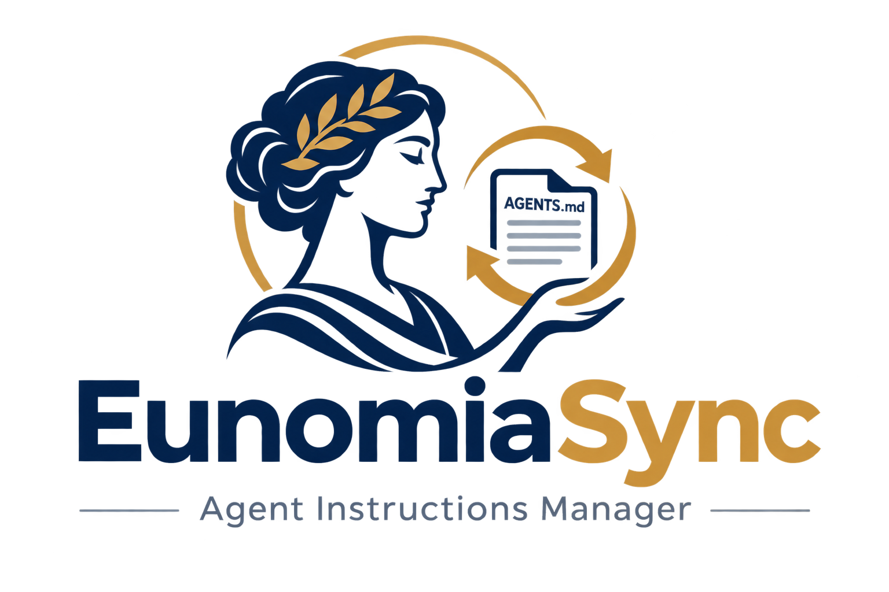

# EunomiaSync — Agent Instructions Manager

EunomiaSync helps developers maintain accurate and up-to-date `AGENTS.md` files across multiple projects. It brings shared instructions and project-specific variations into one manageable system, accounting for differences in tech stacks, development methodologies, conventions, and workflows. It also makes it easy to introduce new rules across all relevant projects without manually updating each file.

It is a cross-platform desktop client built in Rust, running natively on Windows, macOS, and Linux.

<p align="center">
  
</p>

### Why the name EunomiaSync?

**Eunomia** comes from Greek mythology and represents good order, sound governance, and the proper arrangement of things.

This reflects the core purpose of the application: bringing order to a growing collection of project instructions, keeping shared rules consistent while respecting the unique needs of each project.

**Sync** represents keeping `AGENTS.md` files across projects aligned with their source instructions, making it easy to roll out new rules and keep everything up to date as projects evolve.

Together, **EunomiaSync** represents order, consistency, and effortless rule management across multiple projects — without forcing them all to follow exactly the same rules.

### Tech Stack

| Component         | Technology         |
| ----------------- | ------------------ |
| Backend           | Rust               |
| Desktop framework | Tauri 2            |
| Frontend          | Vue 3 + TypeScript |
| UI                | Tailwind CSS       |
| Database          | SQLite             |
| Markdown          | pulldown-cmark     |
| Diff              | similar            |
| File watching     | notify             |
| Config            | serde + TOML       |

### Development without Rust (mock IPC)

The whole frontend talks to Tauri through one facade, `src/ipc`, and that
facade can swap the real backend for an in-browser mock layer backed by
deterministic fixtures — no Rust, no database, just `pnpm`:

```sh
VITE_IPC_MOCK=1 pnpm dev              # UI in a plain browser, mock backend
VITE_IPC_MOCK=1 VITE_IPC_FIXTURES=l pnpm dev   # spec §12.2 set L (500 projects /
                                        # 1000 instructions / 100 000 assignments) for scroll work
pnpm e2e                              # Playwright, mock-backed (playwright.config.ts
                                        # passes the flag to its Vite dev server)
```

- `VITE_IPC_MOCK=1` — every generated command in `src/bindings.ts` is served
  by the mock layer (`src/ipc/mock/`); writes mutate an in-memory store that
  reads back honestly, and error arms reject with the §7.10 `AppError` shape.
  Component tests run under this flag automatically (`test.env` in
  `vite.config.ts`). Unset (production, `tauri dev`), the real commands run.
- `VITE_IPC_FIXTURES` — which fixture profile the mock store builds: `s`
  (default), `m` or `l` (spec §12.2 sets). Fixtures are seeded and
  reproducible: the same profile always yields the same data.
- **Adding data**: extend the generator (`src/ipc/fixtures/generator.ts`) —
  profiles are plain objects; `resetMockState(profile)` in tests seeds a
  custom world. A command added to `bindings.ts` must gain a mock in
  `src/ipc/mock/commands.ts` (the typecheck enforces it) and fixtures to
  serve.

Components never call `invoke()` directly and never import
`src/bindings.ts` — everything goes through `src/ipc` (D-003).

## Localization

The UI is localized with vue-i18n (spec UI-020): one catalog per locale
under `src/locales/` (`en.json` today — the app's single locale), wired in
Composition API mode (`legacy: false`) by `src/i18n/index.ts`. Keys live
in a nested namespace per UI feature (`app.title`,
`app.trackedProjects`; later screens add `project.*`, `library.*`, …),
pluralization uses vue-i18n's pipe plural forms (`zero | one | other`
for English), parameters interpolate as `{name}`, and counts go through
the composer's `n()` so numbers format per locale (1,000).

Every user-visible string in a `.vue` template must come from a key: the
`eunomia/no-raw-ui-text` ESLint rule (eslint.config.js) fails lint on
raw template text, on literals of user-facing attributes (`alt`,
`title`, `placeholder`, `aria-label`, …), and on string-literal
interpolations (`{{ 'Save' }}`) — including copy prefixes around
interpolations like `v{{ version }}` (use a message with a placeholder
instead). The rule is pinned by `src/i18n/no-raw-ui-text.spec.ts`, and
key typos (a missing key renders as the literal key string) are caught
by the catalog-coverage test in `src/i18n/i18n.spec.ts`.

## License

EunomiaSync is dual-licensed under your choice of:

- MIT License ([LICENSE-MIT](LICENSE-MIT))
- Apache License, Version 2.0 ([LICENSE-APACHE](LICENSE-APACHE))
